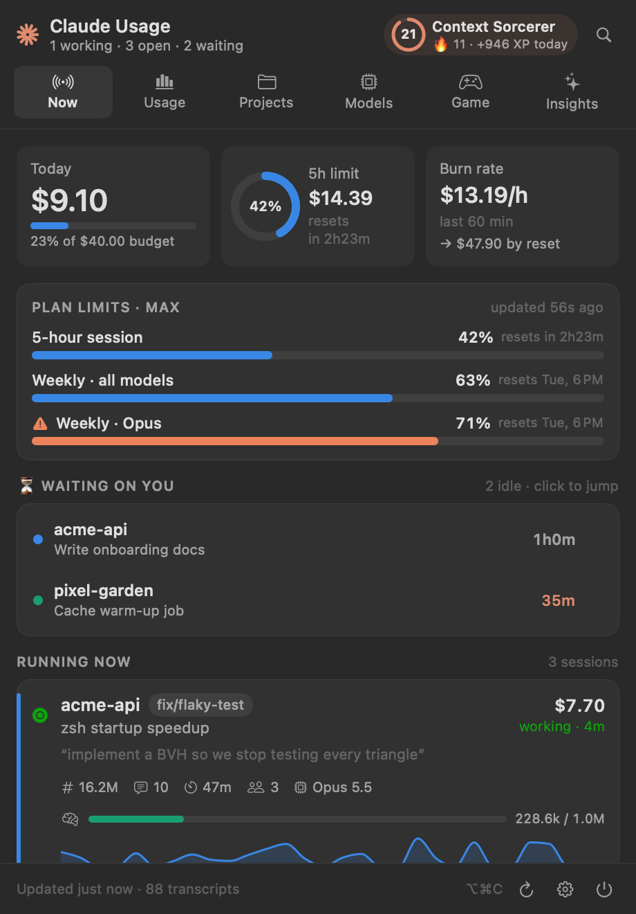
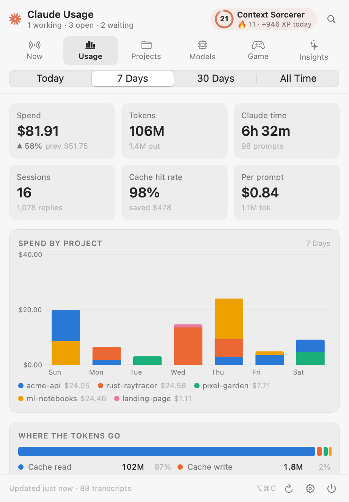
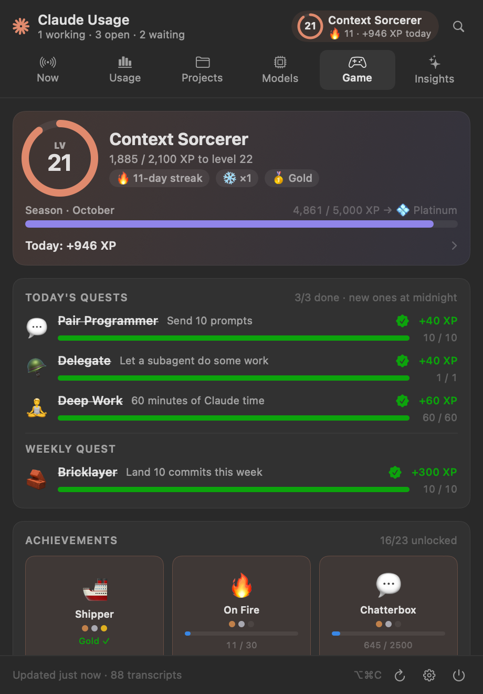
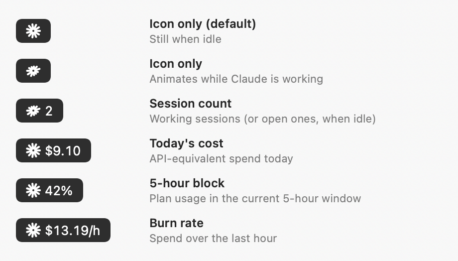
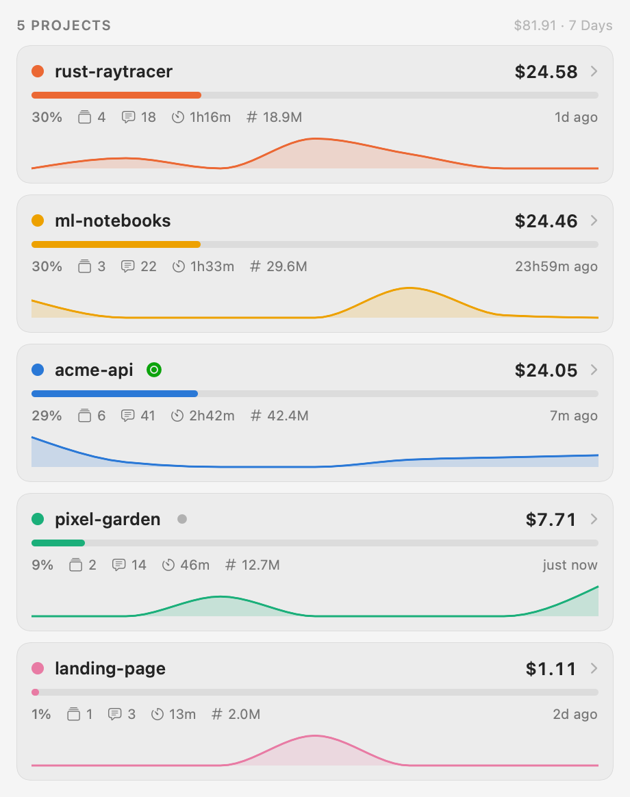
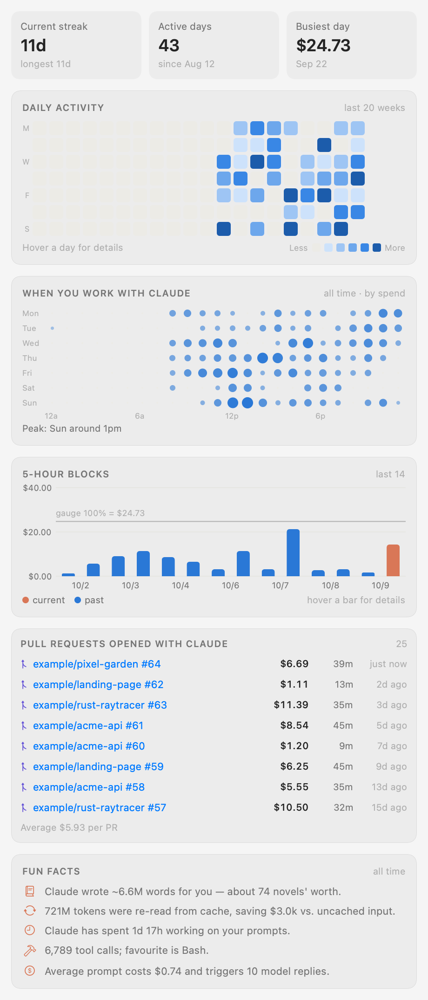
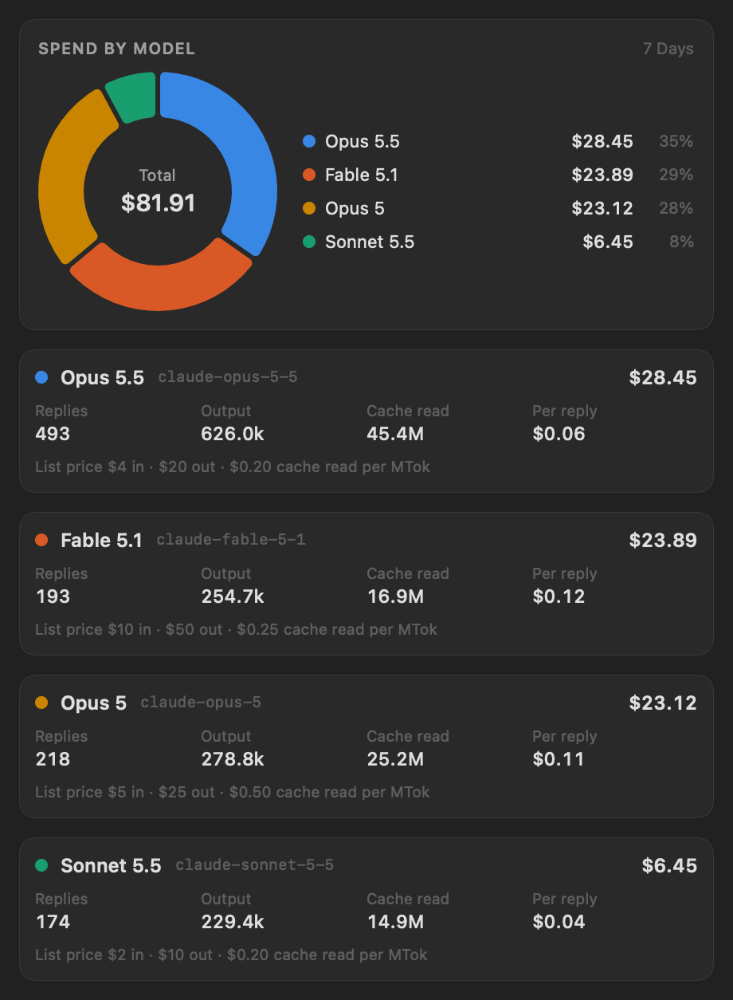
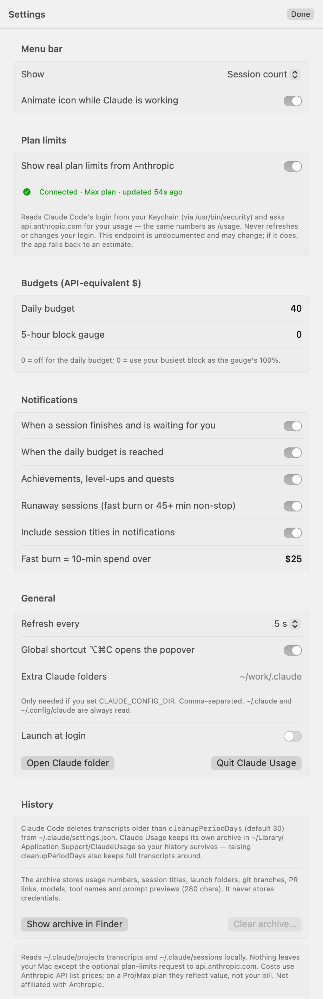

# Claude Usage

**A menu bar app for [Claude Code](https://claude.com/claude-code) on macOS.** See what every Claude session is doing right now, how close you are to your plan limits, where your tokens go across projects, and level up while you ship.

> **Not affiliated with Anthropic.** This is an independent, community-built tool. "Claude" and "Claude Code" are trademarks of Anthropic.

<p align="center">



</p>

<sub>All screenshots use the app's built-in **demo data**. The projects and numbers are made up.</sub>

---

## Contents

- [Features](#features)
- [Install](#install)
- [First launch](#first-launch)
- [Using it](#using-it)
- [Settings](#settings)
- [Privacy and security](#privacy-and-security)
- [How the numbers work](#how-the-numbers-work)
- [Troubleshooting](#troubleshooting)
- [Uninstall](#uninstall)
- [Development](#development)

## Features

- **Live sessions:** every running Claude Code session with its busy/idle status, branch, title, last prompt, cost, and a **context-window meter** that warns before auto-compaction.
- **Waiting on you:** sessions that finished and are idle, longest-waiting first. Click one to jump to its terminal.
- **Plan limits (optional):** your real 5-hour and weekly usage, the same numbers as `/usage` in Claude Code.
- **Usage and spend:** by day, project and model; where the tokens go; what idle breaks cost you in cache rebuilds; cost per PR.
- **Today's timeline:** when each session was working.
- **Search** (⌘F) across every prompt and session you've ever had. Click a result to copy its `claude --resume` command.
- **Notifications:** a session is waiting for you, a session is burning unusually fast, the daily budget is reached, achievements unlocked.
- **The game:** XP, levels, daily and weekly quests, 23 achievements, streaks with freezes, monthly seasons and personal records. It rewards shipping and consistency, never spending.
- **History that lasts:** Claude Code deletes transcripts after 30 days. Claude Usage keeps a compact archive so your stats don't vanish.
- **Lightweight:** native Swift, no dependencies, about 1–3% CPU when idle, light and dark mode.

## Install

**Requirements:** macOS 14 (Sonoma) or later, and [Claude Code](https://claude.com/claude-code). The app reads what Claude Code writes to `~/.claude`.

### Option A: download the app

1. Download **`ClaudeUsage-x.y.z.zip`** from the [latest release](../../releases/latest). It's a universal build for Apple silicon and Intel.
2. Unzip it and drag **ClaudeUsage.app** into **Applications**.
3. The app isn't notarized by Apple, so on first launch **right-click it → Open → Open**. Or, in Terminal:
   ```sh
   xattr -dr com.apple.quarantine /Applications/ClaudeUsage.app
   ```

### Option B: build from source

```sh
xcode-select --install       # Apple's free Command Line Tools (skip if you have Xcode)
git clone https://github.com/lecarre1974/claude-usage.git
cd claude-usage
./install.sh                 # builds, copies to ~/Applications and launches it
```

There's no Xcode project and nothing to download. A locally built app doesn't trigger the Gatekeeper prompt.

### Just want to look?

Run it with fake data. It reads no files and never touches the Keychain:

```sh
./build.sh && build/ClaudeUsage.app/Contents/MacOS/ClaudeUsage --demo
```

## First launch

1. A **✻** appears in your menu bar. There's no Dock icon, by design.
2. Click it. On first open, the app reads your existing Claude Code history, which takes about a second.
3. You'll see a card offering **real plan limits**. Click **Turn on** to see the same 5-hour and weekly percentages as `/usage`, or **No thanks** to skip. You can change this later in Settings. [What this does →](#about-plan-limits)
4. macOS will ask whether Claude Usage may send **notifications**. Allow it if you want "waiting for you" alerts.
5. Optional: open ⚙️ **Settings → Launch at login**.

## Using it

### The menu bar icon



- The **✻ animates** while any Claude session is working and sits still when they're all idle.
- **Hover** for a summary: sessions, plan limits, today's spend, your level and streak.
- **Click** (or press **⌥⌘C**, if you turn the shortcut on) to open the popover.
- The star **grows more rays** as you level up.
- Choose what appears next to the icon under *Settings → Menu bar → Show*.

### The popover

| Tab | What it's for |
|---|---|
| **Now** | Today's spend and budget, the **5-hour limit ring**, burn rate and a projection to the reset. **Plan limits** bars. **Waiting on you**: click a row to bring its terminal forward. **Running now**: one card per session; hover a card for actions (focus terminal, reveal in Finder, copy resume command). **Today's timeline** and **today by hour**, latest prompts, recently closed sessions. |
| **Usage** | Pick a range (Today / 7 Days / 30 Days / All Time). Totals vs the previous period, **spend by project** (hover the bars), **where the tokens go**, **cache rebuilds after breaks**, subagents, web searches, top tools. |
| **Projects** | Every project ranked by spend. Click one to expand its models, tools, sessions (right-click a session for actions) and PRs. |
| **Models** | Spend by model (hover the donut) and per-model detail with list prices. |
| **Game** | Your level, today's XP (click to see the breakdown), daily and weekly **quests**, **achievements** (hover for details), **personal records**. |
| **Insights** | Streaks, a GitHub-style **daily heatmap**, a **weekday × hour** punch card, recent 5-hour blocks, **PRs with their cost and Claude time**, fun facts. |

<p align="center">



</p>

### Keyboard

| Keys | Action |
|---|---|
| **⌥⌘C** | Open or close the popover from anywhere. Off by default; turn it on in Settings, since it overrides ⌥⌘C in other apps. |
| **⌘F** | Search prompts, session titles, projects and branches |
| **Esc** | Leave search |

### The game, briefly

- **Earning XP:** you earn XP for showing up each day, your prompts, PRs, commits, cache-efficient days, streak bonuses, completed quests and achievements. Spending more tokens earns nothing.
- **Quests:** three daily quests, picked fresh each midnight, plus one weekly quest.
- **Streak freezes:** you earn a ❄️ freeze for every 7 active days, up to 2 banked. A missed day uses a freeze instead of breaking your streak.
- **Seasons** run monthly: 🥉 Bronze → 🥈 Silver → 🥇 Gold → 💠 Platinum → 💎 Diamond.
- **History counts:** everything is computed from your history, so on day one you'll already have a level and achievements.

## Settings

Open with the ⚙️ button at the bottom of the popover.



| Setting | Default | What it does |
|---|---|---|
| **Menu bar → Show** | Icon only | Icon only, Session count, Today's cost, 5-hour block %, Burn rate, or a 12-hour sparkline |
| Animate icon while working | On | The ✻ spins while any session is busy |
| **Plan limits** | Off | Real 5-hour and weekly limits from Anthropic ([details](#about-plan-limits)) |
| Daily budget | 0 (off) | Shows a budget bar on the Now tab and notifies you when reached (API-equivalent $) |
| 5-hour block gauge | 0 (auto) | What counts as 100% on the ring when plan limits are off. 0 uses your busiest block so far. |
| Notify: session waiting | On | When a session goes from working to idle after more than 20s of work |
| Notify: daily budget | On | Once per day when you cross your budget |
| Notify: achievements, level-ups, quests | On | 🎮 |
| Notify: runaway sessions | On | A session spending more than **$25 in 10 minutes** (adjustable) or working 45+ minutes non-stop |
| Include session titles in notifications | On | Turn off to keep titles off your lock screen |
| Refresh every | 5 s | How often transcripts are re-checked. Only new bytes are read. |
| Global shortcut ⌥⌘C | Off | Opens the popover from anywhere |
| Extra Claude folders | (empty) | Only needed if you use `CLAUDE_CONFIG_DIR`. `~/.claude` and `~/.config/claude` are always read. |
| Launch at login | Off | Starts Claude Usage when you log in |
| History | | Show the archive in Finder, or **Clear archive** |

<br clear="right">

## Privacy and security

Everything runs on your Mac. The only network request is the **optional, off-by-default** plan-limits call.

| What | Access |
|---|---|
| `~/.claude/projects/**/*.jsonl` | **Read-only.** Claude Code's transcripts: token usage, titles, prompts, tool names. |
| `~/.claude/sessions/*.json` | **Read-only.** Live status of running Claude Code processes. |
| `~/Library/Application Support/ClaudeUsage/archive.json` | **Written** (mode `0600`, in a `0700` folder). A compact history: token counts, models, tool names and timings; session titles, launch folders, git branches and PR links; prompt previews of up to 280 characters. It deliberately outlives Claude Code's transcript cleanup. Clear it from Settings. **No credentials, ever.** |
| Keychain item `Claude Code-credentials` | **Read-only, opt-in.** Only if you turn on plan limits. |
| Notifications | Include session titles by default (visible on the lock screen). You can turn this off. |

### About plan limits

When you turn plan limits on, the app does what Claude Code's own `/usage` command does:

- It reads Claude Code's OAuth login from your Keychain via `/usr/bin/security`.
- It calls `GET https://api.anthropic.com/api/oauth/usage` about every 3 minutes, and when you open the popover.
- The token is held in memory for that request only. The request uses an **ephemeral session** (no disk cache, no cookies) and **refuses redirects**, so the token can't be forwarded anywhere else.
- It is never written to disk, logged, refreshed or modified. If it has expired, the app waits for Claude Code to refresh it.

⚠️ **This endpoint is undocumented.** It's what Claude Code itself uses, but Anthropic doesn't publish it as a public API, so it may change or stop working. If it does, Settings shows the error and the 5-hour ring falls back to an estimate.

## How the numbers work

- **Costs are API-equivalent.** Each reply's tokens (input, output, 5-minute and 1-hour cache writes, cache reads, fast mode) are priced at Anthropic's published API list prices (`Engine/Pricing.swift`). **On a Pro or Max plan you don't pay these.** They show the value of what you used.
- **Deduplication:** one API response spans several transcript lines, so usage is counted once per `message.id + requestId`. Subagent transcripts are included and attributed to their parent session.
- **Projects** are the folder a session was launched in. Git worktrees under `repo/.claude/worktrees/*` roll up into the repo.
- **Context meter** = the prompt size of the session's latest reply, divided by the model's context window.
- **Cache rebuilds** = replies after an idle gap of more than 5 minutes that rewrote most of the context instead of reading it from cache. The figure shown is the extra cost of writing over reading.
- **5-hour blocks** (when plan limits are off) start at the hour of the first message after the previous block ended, and last 5 hours.
- **The game** is a pure function of your history (`Engine/Game.swift`). Replaying it always gives the same result.

## Troubleshooting

| Problem | Fix |
|---|---|
| "ClaudeUsage can't be opened because Apple cannot check it…" | Right-click → **Open**, or run `xattr -dr com.apple.quarantine /Applications/ClaudeUsage.app`. |
| No ✻ in the menu bar | A crowded menu bar can hide it (try ⌘-dragging other icons out of the way), or turn on ⌥⌘C to open the popover directly. |
| Everything shows $0 / no sessions | Use Claude Code at least once. If your config lives somewhere custom (`CLAUDE_CONFIG_DIR`), add that folder under *Settings → Extra Claude folders*. |
| Plan limits show an error | "Login token expired" fixes itself next time Claude Code runs. "No Claude Code login found" means Claude Code uses an API key, not a Pro/Max login; plan limits only exist for subscriptions. |
| No notifications | Check *System Settings → Notifications → Claude Usage*. |
| `./build.sh` fails with "redefinition of module SwiftBridging" | That's a Command Line Tools 16.4 bug. `build.sh` works around it automatically; if it still fails, update the Command Line Tools. |

## Uninstall

```sh
pkill -x ClaudeUsage
rm -rf ~/Applications/ClaudeUsage.app /Applications/ClaudeUsage.app
rm -rf ~/Library/Application\ Support/ClaudeUsage     # the history archive
defaults delete dev.claudeusage.menubar               # settings
```

If you enabled *Launch at login*, turn it off in Settings before deleting, or remove it under *System Settings → General → Login Items*.

## Development

```sh
./build.sh                                   # → build/ClaudeUsage.app
./install.sh                                 # build + install to ~/Applications + launch
./release.sh 1.2.0 [--publish]               # universal zip in dist/ (+ GitHub release)

build/ClaudeUsage --dump                     # text report of everything the parser sees (read-only)
build/ClaudeUsage --snapshot <dir> [--real]  # render every tab + Settings to PNG (demo data unless --real)
build/ClaudeUsage.app/Contents/MacOS/ClaudeUsage --demo   # run with synthetic data
```

No Xcode project and no dependencies: the scripts call `swiftc` directly. `build.sh` also hides a stale modulemap shipped with Command Line Tools 16.4, using a VFS overlay without modifying system files.

```
Sources/ClaudeUsage/
  Main.swift                 entry point, NSStatusItem + NSPopover, global hotkey
  UsageStore.swift           @Observable store: refresh loop, notifications, actions
  Engine/
    TranscriptScanner.swift  incremental JSONL tailer, dedupe, sessions, archive
    LiveSessions.swift       ~/.claude/sessions reader
    PlanLimits.swift         opt-in plan limits via Claude Code's OAuth login (read-only)
    Stats.swift              range rollups, 5h blocks, streaks, calendar helpers
    Analytics.swift          cache rebuilds, per-PR cost, concurrency, timeline, day stats
    Game.swift               XP, levels, quests, achievements, records, seasons
    Pricing.swift            per-model prices
    DemoData.swift           synthetic data for --demo and screenshots
    Snapshotter.swift        screenshot renderer
  Views/                     SwiftUI + Swift Charts
```

Issues and pull requests are welcome.

## License

MIT. See [LICENSE](LICENSE).
